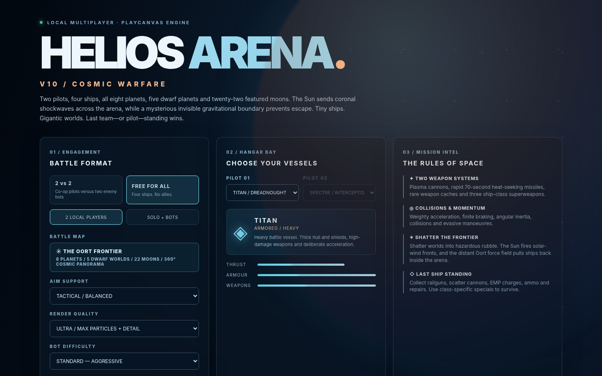

# HELIOS ARENA V10 — COSMIC WARFARE

## V10.1 startup repair (November 9, 2026)

A code bug in V10 could crash scene creation **after PlayCanvas successfully loaded**. `src/world.js` invoked `makeEmissive()` when creating the Sun's corona, other planets' atmospheres, Saturn/Uranus rings, solar pulses, and breakup flashes, but that function was not defined. This produced `ReferenceError: makeEmissive is not defined` during startup and looked like a generic **3D ENGINE STARTUP ERROR**.

**Fixed:** a reusable emissive/transparent material helper in `src/graphics.js`, imported into `src/world.js`; explicit `resourceHandlers=[]` in PlayCanvas AppBase setup; and a startup report that shows whether the failure occurred while downloading the engine, creating WebGL2, initializing PlayCanvas, or building the solar system. Three additional scene-construction regression tests cover those materials and a simulated solar event/planetary rupture. The underlying gameplay is otherwise unchanged.

**Updating an existing V10 repository:** Replace the affected source files and `index.html` from this release, then redeploy. The full ZIP also contains every prior asset and the existing GitHub Actions workflow. After deployment, hard-refresh the game page (`Ctrl + Shift + R`). If the diagnostic instead says **LOADING ENGINE MODULE**, switch Pages to **GitHub Actions** (recommended, using the included workflow), or run `fetch-engine.bat`, commit `vendor/playcanvas.mjs` and use branch-based Pages. The archive does not include the binary engine because its download hosts are unavailable in this build environment.

---


**PlayCanvas Engine 2.23.3 · Static GitHub Pages site · Local split-screen combat · No backend**



*Menu-only Chromium preview; full PlayCanvas WebGL rendering remains unverified.*

V10 is a substantial gameplay expansion of Helios Arena V9.3, with battle pickups, three different signature superweapons, guided-missile revisions, new physics for the Oort boundary, an original panoramic sky, upgrades to the command cockpits and controls, and tactical AI that seeks pickups. All weapons and pickup interactions are executed in the shared battle simulation, not merely cosmetic HUD buttons.

## Gameplay

- **Game modes:** 2-player local co-op versus two computer pilots; four-vessel free-for-all; solo-with-bots. Select Rookie / Standard / Veteran opponents.
- **Ships:** Spectre fast interceptor, Vanguard all-round assault, Titan heavyweight; independent flight and weapons characteristics, cockpit and chase cameras.
- **Standard weapons:** repeatable heat-managed laser cannon, rapid-launch heat-seeking missiles, independent missile lock timer, physical decoy satellites. Missile initial speed 115 navigation units/sec, top speed 230, simulated lifetime 72 seconds. Guidance compensates for target velocity, can reacquire line of sight, and is turn-rate limited.
- **New collectible weapon caches:** 16 reusable visible 3D caches located in battle space, with respawn cooldowns. Fly within the pickup radius to obtain an item. Both human and AI pilots compete for the same caches.
  - Railgun — 7 precision shots, 295 NU/s projectile speed, high damage.
  - Plasma scatter — 24 close-range volleys of 9 bolts.
  - EMP disruptor — 3 area pulses disabling enemy locks and weapons temporarily.
  - Overcharge — 24 seconds of boosted laser output.
  - Nanite repair — restore hull and shields.
  - Ordnance cache — replenish missiles and decoy satellites.
- **Unique signature specials:**
  - Spectre: **Swarm Barrage** — 10 independent guided micro-missiles; 3 charges, 26-second cooldown.
  - Vanguard: **Nova Pulse** — visible forward blast with 1.4-second charge, 4 charges and 21-second cooldown.
  - Titan: **Cataclysm Warhead** — launched wide-area blast and expanding shockwave; 2 charges, 36-second cooldown.
- **AI:** bots select desirable pickups when damaged or under-equipped, collect them by flying nearby, use special weapons and collectible guns, pursue opponents, acquire locks and deploy decoys.
- **Environment:** Sun, all eight planets, five dwarf planets, 22 selected moons, Saturn/Uranus rings, asteroids, breakable structures, staged planetary destruction with drifting debris, and periodic solar wind blocked by intact worlds.
- **Oort boundary:** visual cosmic panorama and invisible progressively stronger inward force, with an emergency hard boundary. There are no 4,600 procedural ice chunk meshes. The real Oort Cloud is not a solid boundary; this is a deliberately fictional battle-arena mechanic.
- **Display:** independently rendered 3D cockpits for both human pilots, a HUD with weapons/special/ammunition, clear target brackets, lead pip, offscreen target indicators, lock progress and nearby pickup markers.

**Scale note:** Planet and major moon sizes follow approximate Jupiter-relative radius ratios, except tiny-world minimums. Spacecraft, the Sun and travel distances are still scaled for the game. Planet destruction and solar wind are cinematic fiction.

## Controls

| Action | Player 1 | Player 2 |
|---|---|---|
| Thrust / reverse | W / S | I / K |
| Strafe | A / D | J / L |
| Pitch / yaw | Mouse | Arrow keys |
| Roll | Q / E | [ / ] |
| Vertical thrusters | Space / C | , / . |
| Boost | Left Shift | Right Shift |
| Brake | X | Backspace |
| Fire laser | Left click or F | N |
| Heat-seeking missile | Right click or R | M |
| **Use collected weapon (railgun, scatter, EMP)** | **1** | **8** |
| **Fire signature special weapon** | **2** | **9** |
| Deploy decoy satellite | G | U |
| Cycle target | Tab | Enter |
| Select ships / worlds | T | Y |
| Toggle cockpit / chase | V | O |
| Tactical zoom | Z | H |
| Pause | P or Escape | — |

The collected weapon and special also have clickable HUD controls. Controller support remains: right stick steers, left stick translates, right trigger lasers, left trigger missiles, face buttons for decoy/target, and **View (button 8) for collected weapon / Menu (button 9) for special**, depending on controller mapping. For the least input conflict with two humans, use keyboard/mouse for Player 1 and controller for Player 2.

### Important weapon behavior

For ordinary guided missiles, keep a ship inside the acquisition cone until target lock completes. Firing consumes ammo. The 72-second lifetime is a *maximum simulation time*, not a promise that every missile will stay locked for its entire flight; it can hit a body, be diverted by a decoy, leave the sensor range or lose sight of the target. Spectre's special swarm can launch with autonomous targeting. Vanguard takes time to charge its beam. All three specials have limited ammunition and cooldowns.

## Publish on GitHub Pages — recommended approach

**Use the included GitHub Actions deployment workflow to avoid the previous PlayCanvas CDN startup failures.** This performs the engine download when GitHub builds the site and includes a local copy in the deployed files.

1. Unzip and put the **contents** of the project in your repository root (`index.html`, `src/`, `assets/`, `.github/`, `vendor/`, etc.). Preserve hidden `.github/workflows/pages.yml`.
2. Commit/push to the `main` branch. The repository can be public or private subject to your GitHub Pages plan.
3. Go to your repo **Settings → Pages** and choose **Build and deployment → Source: GitHub Actions**.
4. Under the **Actions** tab, run **Deploy Helios Arena V10 (bundled PlayCanvas)** manually, or push another commit to trigger the workflow.
5. Wait for successful deployment. Open `https://<username>.github.io/<repo>/`.
6. If replacing an older edition, use a hard refresh (`Ctrl + Shift + R`).

GitHub Actions needs permission to deploy Pages and outbound internet access to download the official PlayCanvas Engine at build time. If the download fails, the workflow fails visibly instead of quietly publishing a broken site. No runtime build process or backend is used by the deployed game.

### Alternate: publish from branch as before

If you prefer **Settings → Pages → Deploy from a branch → main → /root**, run `fetch-engine.bat` on Windows (or `./fetch-engine.sh` on Linux/macOS) before uploading. Verify the resulting **`vendor/playcanvas.mjs`** exists and is at least 100 KB. Upload/commit that engine file too. The game tries the local engine first, followed by three CDN sources if it is missing.

**The ZIP intentionally does not claim to contain the PlayCanvas engine binary.** Internet access to the engine hosts was blocked in the creation environment, so I could not vendor it. The included GitHub Actions workflow or Windows download script resolves this before deployment. Do not open `index.html` via `file://` because ES modules need HTTP.

## Run locally

1. Download the engine with `fetch-engine.bat` (Windows) or `./fetch-engine.sh`.
2. Launch `run-local.bat` or run `python -m http.server 8000` from this folder.
3. Navigate to `http://localhost:8000`, choose mode and ships, then click **LAUNCH SKIRMISH**.
4. Click the 3D view for mouse capture; press Esc to exit capture/pause.

## Graphics presets

In the Hangar select **Balanced** (recommended for two-player split-screen), **Ultra** (higher resolution and world/effect budget), or **Performance** (reduced render scale and particle/asteroid budget). The 360-degree Milky Way backdrop is a bundled 3072 × 1536 original WebP panorama rather than thousands of individually rendered star/ice meshes.

## Project structure

```text
index.html                 Independent lobby, two cockpit HUDs and weapon actions
style.css                  Visuals, targeting and pickup interface
assets/*.jpg               Local planet and moon textures
assets/sky/*.webp          Original 360-degree cosmic sky panorama
src/engine.js              Official PlayCanvas 2.23.3 local-first loader + fallback CDNs
src/boot.js                Asynchronous loading and diagnostics, retry
src/menu.js                Menu that functions before the 3D engine
src/main.js                Split-screen controls, gamepad, projection and HUD
src/rules.js               Combat math and 36-body world data
src/warfare.js             V10 missile guidance, pickups, specials and Oort math
src/combat.js              Match simulation, AI, weapons, ship physics, pickups
src/world.js               Solar system, destruction, solar weather, 360° backdrop
src/graphics.js            Spacecraft, enclosed cockpit geometry, materials, weapons
src/music.js               Original synthesized music
.github/workflows/pages.yml  Official-engine download and GitHub Pages deployment
tests/*.test.mjs           Node automated tests and combat mock simulation
vendor/README.txt         Local PlayCanvas setup and engine download explanation
fetch-engine.bat/.sh       Download official PlayCanvas to self-host in branch deployments
```

Run `npm run check` for JS parsing and `npm test` for rule, integration-mock and structural tests. No `npm install` is needed for these checks; Node.js 20+ is sufficient.

## Validation and limitations

V10 includes rule tests and a PlayCanvas-independent mocked runtime test of the real `ArenaGame` class. A Chromium **menu-only** check verified that lobby controls work without the PlayCanvas Engine. Full WebGL scene rendering, live 3D interaction, and two physical controllers **could not be verified** in the creation environment because browser navigation / CDN access was blocked. They need a test after deployment. No online multiplayer or online matchmaking is included.

## Art, data and license

See [CREDITS.md](CREDITS.md). The game contains original procedural panorama and geometry, plus adapted local planet texture assets. This is a fictional, stylized simulator; the Oort gravitational boundary is invented for gameplay.
